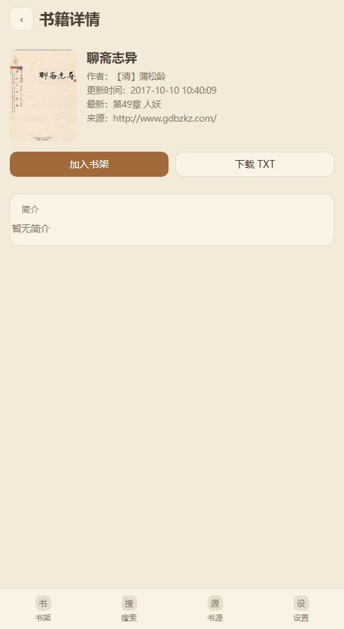

# FnReader：把 Legado 书源生态移植到飞牛 fnOS 的 Web 阅读器

**摘要**　Legado（阅读）是 Android 上最完整的开源阅读器，它的价值不在界面，而在积累下来的数千条社区书源规则。但这套规则只能在 Android 客户端里执行，桌面上没有等价实现，飞牛 fnOS 这类 NAS 系统更无从使用。本文把 Legado 的书源能力重做成一个跑在 NAS 上的 Web 应用：服务端用 Node.js 重新实现规则引擎（CSS、XPath、JSONPath、正则、`@` 选择器链、索引语法、`@js:` 沙箱），客户端是零构建步骤的原生 JS 单页应用，整体按飞牛 FPK 应用格式打包，通过系统统一网关暴露。移植过程中真正花时间的不是把规则跑通，而是三类摩擦：一是 Legado 规则里的 PCRE 写法与 JavaScript 正则的语义差异，二是书源站点普遍存在的「最新章节」与「完整目录」两套结构，三是 fnOS 平台自身的约束——覆盖安装不生效、WebView 缓存旧页面、应用没有系统安装权限。全文记录了这些问题的现象、定位依据与处理方式。当前版本 1.7.11，安装包 588 KB，端到端测试 35 条断言全绿，实测导入书源 1062 条，缓存命中的翻页约 20 ms，整本导出 TXT 单本 860 KB。

**关键词**　Legado 书源；规则引擎；飞牛 fnOS；FPK；WebDAV；Node.js

---

## 1 引言

Legado 的书源是一份 JSON 描述：搜索地址、列表选择器、各字段抽取规则、目录与正文规则。规则里可以嵌 CSS 选择器、XPath、正则替换，也能写 `@js:` 调用脚本。这套机制让同一个客户端适配了几千个站点，但执行环境被绑死在 Android —— 规则解析器是 Kotlin 写的，`java.ajax` 之类的 API 只在安卓运行时里存在。

NAS 用户的实际诉求很朴素：不想为了看小说再开一台设备。飞牛 fnOS 提供了应用商店与一键安装的 FPK 格式，缺的只是一个能跑规则的阅读器。于是有了本文的工作：**用 Node.js 重写规则引擎，把 Legado 的书源直接搬进 NAS 的浏览器**。

移植路线上有两个约束是硬的，先摆出来。其一，Legado 的规则语法没有正式规范，只能对着社区书源反推语义，所以引擎必须「宽容」——遇到不认识的写法要降级而不是崩溃。其二，fnOS 的更新链路与 Linux 包管理完全不同：`appcenter-cli install-fpk` 对已安装应用返回成功但不替换文件，应用本身也没有系统安装权限。后文的设计选择大多由这两点推出来。

---

## 2 系统约束与总体架构

### 2.1 运行环境

| 项 | 取值 |
| --- | --- |
| 宿主 | 飞牛 fnOS（Debian 系），应用以 `legado` 用户运行 |
| 运行时 | `nodejs_v22`（平台依赖应用，安装时自动拉起）|
| 入口 | 统一网关 `/app/legado-web/`，同时监听 `:1122` 与 `app.sock` |
| 数据目录 | `/vol2/@appdata/legado-web`（升级保留）|
| 包格式 | FPK（`manifest` + `config/privilege` + `cmd/main` + `app/`）|
| 产物大小 | 588 KB（含前端、服务端 bundle 与更新日志）|

### 2.2 分层

服务端按职责拆成 12 个模块，彼此单向依赖：

| 模块 | 职责 |
| --- | --- |
| `server.js` | HTTP 路由、SSE 搜索、下载任务、更新检查、手机 API、生命周期 |
| `books.js` | 搜索 / 详情 / 目录 / 正文的完整流程，结果过滤与目录补全 |
| `rules.js` | 规则解析与求值（`@` 链、`class./text.` 前缀、索引、`##替换##`）|
| `xpath.js` | 精简 XPath 引擎（`//a/@href`、`text()`、`position()`）|
| `jsrules.js` | `@js:` 规则沙箱（`node:vm`），模拟少量 `java.*` API |
| `util.js` | 出站请求：超时、重试、全局并发信号量（4）|
| `store.js` / `minidb.js` | 书源 / 书架 / 配置落盘；JSONL 键值库 |
| `cache.js` / `searchcache.js` | 章节正文磁盘缓存；搜索结果缓存（键带版本前缀）|
| `replace.js` | 替换 / 屏蔽规则（兼容 Legado `exportReplaceRule.json`）|
| `article.js` | 订阅条目正文抽取 |
| `dav.js` | WebDAV：`/dav/books` 只读、`/dav/backup` 读写 |

---

## 3 书源规则引擎

### 3.1 规则语法的还原

Legado 的规则没有规范文档，这里按社区书源的实际用法归纳出四层：

1. **选择器层**：`class.xx`、`tag.xx`、`id.xx`、`text.xx`，对应 CSS 的 `.xx`、`xx`、`#xx` 与文本匹配；
2. **链式层**：`@` 分隔多级选择，例如 `id.chapterlist@p@a`；
3. **索引层**：`a.0`（第 0 个）、`p!0`（倒数第 0 个）、`li.1:2:3`（多个下标）；
4. **后处理层**：`##正则##替换` 与 `:正则` 提取。

其中 `@` 链与索引是移植重点——它们不是标准 CSS，必须自己解析。实现上把规则切成段落（`parseSegment`），逐段求值并把结果集传给下一段，遇到属性写法（`@href`、`@text`）直接在当前节点上取值。

### 3.2 PCRE 与 JavaScript 正则的差异

书源里的正则大量使用 PCRE 特性，直接 `new RegExp` 会报错。实测一份 38 条规则的 `exportReplaceRule.json`，其中 20 条是正则，有 5 条在 JS 里无法直接编译：

| PCRE 写法 | JS 处理 |
| --- | --- |
| `(?i)` / `(?mi)` 内联修饰符 | 提取为 `i` / `m` flag，出现在中间的删掉 |
| `\h`（水平空白） | 改写为 `[ \t]` |
| `\R`（任意换行） | 改写为 `\n` |
| 变长后行断言 | V8 支持，直接保留 |

改写后 20/20 全部编译通过。单条规则失败被 `try/catch` 吞掉，不影响其余规则。

### 3.3 `@js:` 沙箱

规则里的 `replacement` 允许写 `@js:` 脚本，Legado 里这些脚本能调 `java.ajax`、`base64Decode` 等。移植时用 `node:vm` 建沙箱，提供 `result`、`getString`、`base64Encode/Decode`、`md5Encode` 等常用函数；`java.ajax` 用同步 HTTP 兜底并要求显式超时——早期版本正是因为在下载线程里同步执行 `java.ajax` 导致应用假死。

### 3.4 结果过滤

期刊杂志类站点会把「2026年第11期」这类期号当成书名返回。判定规则分三档：

```
^\d{4}年\s*(第)?\d{1,2}期                 → 期刊期号，丢弃
^\d{4}[-./年]\d{1,2}([-./月]\d{1,2})?$    → 纯日期，丢弃
第\d{1,3}期$ 且作者为「未知作者」           → 丢弃
```

单纯含「第…期」但作者正常的结果保留，避免误杀正经书名。

### 3.5 目录补全

书源站点常见两套结构：书页顶部「最新章节」（十几条）与单独的完整目录页。若 `ruleToc.chapterList` 命中的是前者，用户看到的就是「这本书只有 12 章」。

处理方式是补全后校验：

1. 目录少于 30 章时，先在书页上找「全部章节 / 完整目录」链接；
2. 再尝试 `<书页>/index.html`、`<书页>/all.html`；
3. 新目录必须比原目录多 50% 以上、且包含原目录至少一半的章节才采用。

实测某书源的书页只暴露 12 章（第 38–49 章），换到另一个书源后为 **497 章**（首章「后记」，末章「李檀斯」）——这也正是「换源」功能存在的意义。

---

## 4 数据与缓存

数据全部落在 `/vol2/@appdata/legado-web`，升级不丢：

| 文件 | 内容 |
| --- | --- |
| `sources.json` | 书源数组（实测 1062 条）|
| `books.json` | 书架（含阅读进度）|
| `config.json` | 设置、`apiToken`、保存目录 |
| `downloads.json` | 下载索引 |
| `library.json` | 已缓存书籍清单（书名 / 来源 / 章节数）|
| `db/search-cache.jsonl` | 搜索结果缓存 |
| `cache/` | 章节正文缓存 |
| `webdav/backup/` | WebDAV 备份区 |

两级缓存各管一段：

- **搜索结果缓存**：键为「最终请求 URL + 请求体」的 SHA1（带 `v3` 版本前缀，改逻辑就换前缀）。命中直接返回，空结果只缓存 10 分钟。实测同一关键词连搜两次，缓存条目数不变，说明全部命中。
- **章节缓存**：正文落盘并按章节索引预取后两章，缓存命中的翻页约 20 ms。

---

## 5 客户端与阅读体验

前端是单个 `app.js`（约 1900 行）+ `style.css`，按 `renderXxx()` 划分页面，无框架、无构建步骤。

### 5.1 阅读页

采用类 Kindle 的排版（图 3）：顶栏半透明毛玻璃、衬线正文、首行缩进 2em、两端对齐；底部固定条显示 `4 / 50 · 8%` 与一条 2 px 进度线。顶栏右侧的 `⇄` 为换源入口，`☰` 为目录抽屉（带章节序号与「共 N 章」）。

### 5.2 搜索、详情与换源

搜索结果流式返回（SSE），可按「仅可用 / 全部书源 / 分组」筛选，并显示「其中 N 个命中缓存」（图 2）。点卡片进入详情页（图 4），详情页可直接加入书架，或在书架中直接开始阅读。

换源按书名跨源重搜，按「完全一致 → 包含 → 被包含」排序，最多 30 条；切换后按**章节标题**定位，尽量停在原来那一章。

### 5.3 订阅

RSS / Atom 条目可一键「加入书架」，同一订阅永远映射到同一本书（`bookUrl = feed://<订阅地址>`），刷新时按条目链接去重，只把新条目插到最前。正文按条目链接抓取原文，抽取优先级为 `article` → `.post-content` → `#content` → `main`，结果进内存缓存（上限 300 条）。

---

## 6 打包、部署与更新

### 6.1 FPK 打包

`tools/build-fpk.sh` 做四件事：esbuild 把服务端打成单文件 bundle → 组装 `build/legado-web/` → 校验关键文件 → `fnpack build` 产出 588 KB 安装包。更新日志随后打进 `app/web/docs/changelog.txt`，应用内「更新日志」弹窗直接读这个文件。

### 6.2 缓存与版本自愈

静态资源带 `?v=<版本>` 指纹，服务端对 `.html/.js/.css/.txt` 下发 `no-cache`。早期版本给 `app.js` 设了 `max-age=86400`，结果用户端缓存了旧页面、界面一直显示旧版本号——这个坑的解法是**页面自校验**：

```js
fetch('./api/health?ts=' + Date.now(), { cache: 'no-store' })
  .then(r => r.json())
  .then(d => {
    if (d.version !== meta.content) location.replace(url + '?b=' + d.version);
  });
```

带 `b=` 参数时不再重载，避免服务端与页面版本不一致时的死循环。

### 6.3 更新链路

`/api/update/check` 读 GitHub Release 并比对版本；`/api/update/download` 把 fpk 下到 `更新包/` 子目录。国内网络下 `github.com` 的 release 资源会跳转到 `release-assets.githubusercontent.com`，该域名直连超时，因此下载按顺序回退四个通道（直链 + 三个镜像），并校验文件大小（<10 KB 视为失败）。

自动安装需要免密权限。`tools/enable-update-permission.sh` 写入一条 sudoers 规则：

```
legado ALL=(root) NOPASSWD: /usr/local/bin/appcenter-cli
```

有权限时后台执行 `stop → install-fpk → start`（应用会被自己停掉，所以必须 detach），无权限则回退为手动安装指引。

---

## 7 对外接口

| 能力 | 路径 | 鉴权 |
| --- | --- | --- |
| WebDAV | `/dav/books/`（只读）、`/dav/backup/`（读写）| Basic，密码 = apiToken |
| 手机 API | `/api/m/shelf`、`/library`、`/toc`、`/content`、`/progress` | `X-Api-Token` |
| 书源桥 | `/api/m/booksource`、`/api/m/legado/{search,book,toc}` | `X-Api-Token` |

WebDAV 让 Legado 的「备份与恢复 → WebDAV」直接指向 NAS；书源桥则把书架包装成一条 Legado 书源，安卓端导入后即可读 NAS 上的内容。

---

## 8 测试与结果

`test/e2e.js` 自带模拟书源站，覆盖导入、搜索、加入书架、目录、正文分页、进度、下载、订阅等 35 条断言，全部通过。

| 指标 | 实测值 |
| --- | --- |
| 安装包 | 588 KB |
| 书源导入 | 1062 条（历史最大 1146 条）|
| 单章翻页 | 约 20 ms（缓存命中）|
| 搜索（3 源）| 164 本，其中 3 源命中缓存 |
| 整本 TXT | 单本 860 KB（2494 段）|
| WebDAV 取书 | 200，860 KB |
| 替换规则 | 38 条导入，20 条正则全部编译通过 |

---

## 9 已知限制

1. **规则覆盖不全**：书源语法没有规范，冷门写法仍可能失败；
2. **目录可能不完整**：若站点既无「全部章节」链接、也无 `index.html`，且规则只匹配最新章节区块，则无法补全——此时应换源；
3. **无法原地覆盖安装**：`appcenter-cli install-fpk` 对已安装应用不替换文件，升级必须 `uninstall → install`（数据目录保留）；
4. **下载源受网络影响**：release 资源依赖镜像回退，镜像失效时需手动下载；
5. **反爬与 WebView 规则**：依赖 WebView 执行的规则无法在服务端还原，这类书源会被跳过。

---

## 10 用 AI 继续开发

项目刻意做成「AI 友好」：无构建步骤、无框架、目录扁平、测试自带模拟站。把仓库交给 AI 后粘下面这段即可开工（更细的说明见 [docs/AI构建指南.md](docs/AI构建指南.md)，内含 8 段可直接复制的提示词）。

```text
你是 FnReader（飞牛 fnOS 上的 Legado 书源阅读器）的开发者。请先按顺序读：
1. docs/AI构建指南.md   2. legado-web/manifest
3. server/src/server.js 4. server/src/books.js
5. app/web/app.js       6. test/e2e.js

读完向我复述：服务端有哪些模块、前端有几个页面、数据存在哪里、怎样才能发一版。
不要先写代码。
```

约定（AI 与人都遵守）：

- 服务端接口放 `server.js` 的 `route()`，移动端接口走 `checkApiToken`；
- 前端新页面 = `renderXxx()` + `router` 注册；样式追加到 `style.css` 末尾；
- 不引入前端框架与新的 npm 依赖；
- 改动要补 `test/e2e.js` 断言；
- **每次改动都要推源码并发版**：`bash tools/publish.sh "说明"`。

---

## 附录 A 项目结构

```
legado-web/            FPK 工程
├── manifest           版本、依赖、端口
├── config/            privilege（run-as package）、resource
├── cmd/               start / stop / status 生命周期
├── app/ui/            桌面入口与图标
├── app/web/           前端（index.html / app.js / style.css）
└── app/server/src/    服务端 12 个模块
tools/                 build-fpk.sh / publish.sh / release.py / deploy.sh / backup.sh
docs/                  使用说明、更新日志、AI 构建指南、手机 API、WebDAV
dist/                  发布产物与示例书源
test/                  e2e.js、mock-site.js、preview.js
```

## 附录 B 图示


*图 1　书架：封面、阅读进度与长按菜单*


*图 2　搜索：多源流式返回，状态栏显示缓存命中数*


*图 3　阅读页：类 Kindle 排版，顶栏 `⇄` 为换源，底部为章节进度*



*图 4　详情页：封面、来源、简介与加入书架*


*图 5　书源管理：分组与勾选批量删除*


*图 6　设置：手机接入、屏蔽规则、版本更新*

## 参考

1. gedoor. Legado（阅读）[EB/OL]. https://github.com/gedoor/legado
2. 飞牛 fnOS 开发者文档：应用开发与 fnpack [EB/OL]. https://developer.fnnas.com/docs/
3. 本项目源码与发布 [EB/OL]. https://github.com/TZYLXS/FnReader

## License

[Apache-2.0](LICENSE)
